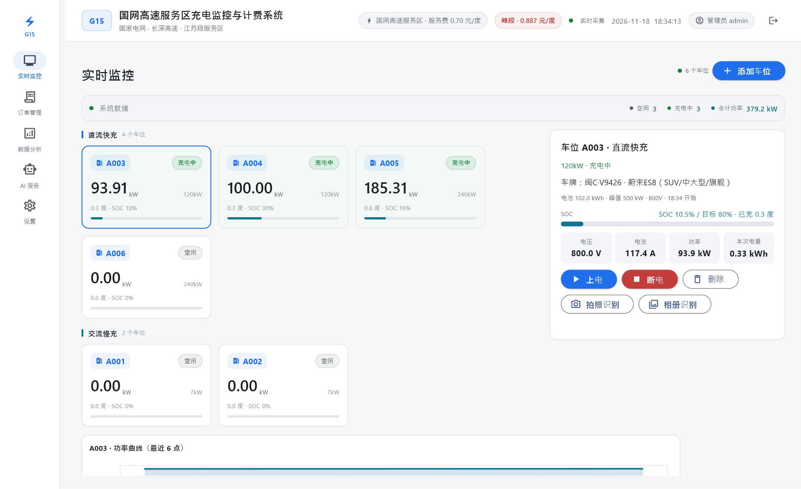
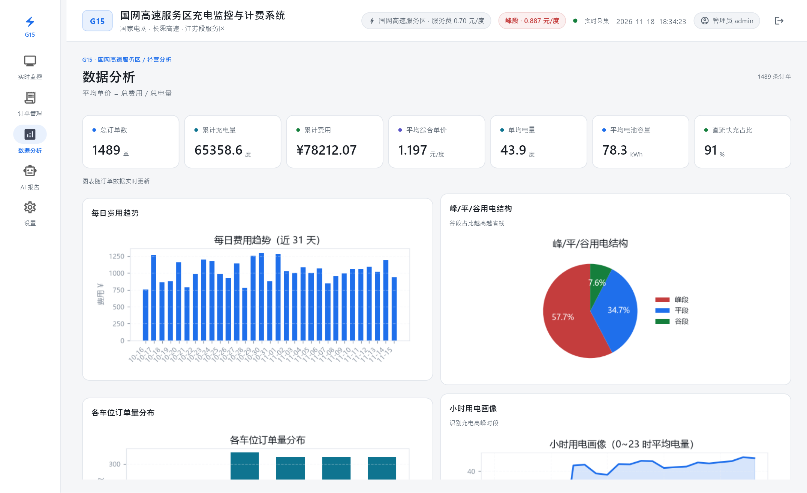
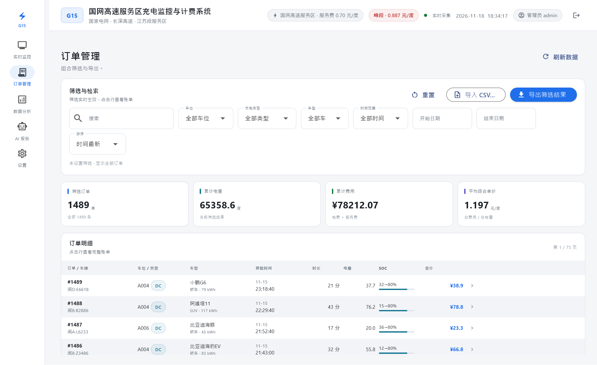
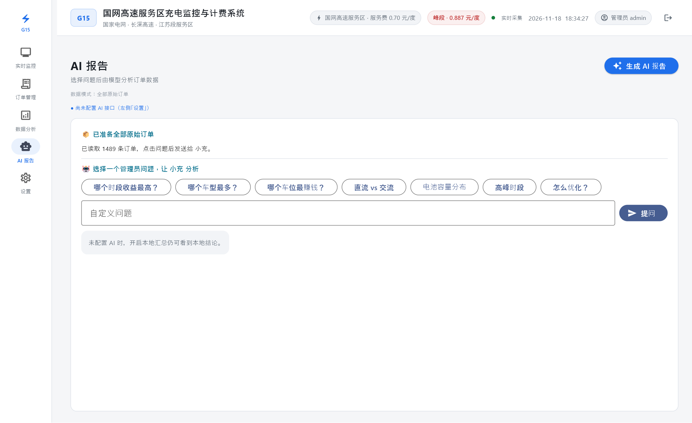

# 国网高速服务区充电监控与计费系统

基于 [Flet](https://flet.dev) 的跨平台充电站监控与分时计费桌面应用。系统以国网高速服务区为场景，覆盖车位管理、实时充电监控、会话控制、分时计费、订单管理、数据分析和大模型报告。

遥测数据由内置模拟器按车辆与充电桩的物理参数生成，采集层通过 `DataCollector` 接口隔离，可替换为 MQTT / HTTP 的真实设备上报。

预编译的 Windows / macOS 程序见 [Releases](https://github.com/KayYiny/evcharge/releases)。

<p align="center">
  <a href="https://github.com/KayYiny/evcharge"></a>
  
  
  
  
</p>

## 界面预览

| 实时监控 | 数据分析 |
|---|---|
|  |  |
| **订单管理** | **AI 报告** |
|  |  |

## 功能

- **实时监控**：车位卡片墙按直流快充 / 交流慢充分组并随窗口自动换行，展示状态、功率、电量与 SOC；右侧详情面板显示车型、电池、电压平台、SOC 进度与实时功率曲线。
- **会话控制**：用户上电、用户断电、达到目标 SOC 自动结算。支持拍照或相册识别车牌后直接上电。
- **订单管理**：车牌 / 车位 / 类型 / 车型 / 时间范围组合筛选，按时间、金额、电量、时长排序，分页、账单详情、当前筛选导出 CSV，也可追加导入 CSV。
- **数据分析**：订单数、电量、费用、综合单价等 7 项指标，以及每日费用、峰平谷结构、各桩订单量、小时画像、电池容量分布、车型结构 6 组图表。
- **AI 报告**：兼容 OpenAI `/chat/completions` 的接口，可发送本地汇总或全部原始订单；未配置接口时仍可查看本地统计结论。
- **设置**：站点名称、电价档、服务费、刷新间隔、AI 与视觉模型、账号密码，以及数据备份 / 导入 / 清空。

## 账号与角色

登录页是唯一入口，管理员和车位用户共用一个表单。

| 角色 | 用户名 | 默认密码 | 可见页面 |
|---|---|---|---|
| 管理员 | `admin` | `admin` | 实时监控、订单管理、数据分析、AI 报告、设置 |
| 车位用户 | 车位名（如 `A001`） | `admin` | 我的车位、我的订单 |

- 车位账号在管理员添加车位时自动创建，用户名即车位名；车位名站内唯一（忽略大小写）。
- 退出登录不会中断正在进行的充电，采集与计费循环常驻后台，直到用户断电或管理员断电。
- 删除车位会同步删除账号，历史订单保留；订单按车位 uid 归属，删掉后重建同名车位不会串单。

## 充电与会话模型

- 站点初始为空，由管理员在「实时监控」页逐个添加车位：交流慢充 7kW，或直流快充 60 / 120 / 240kW。
- 每个车位单枪，实际功率取 `min(车辆峰值, 桩实测峰值, 电压 × 单枪电流上限)` 再乘 SOC 系数。
- 直流桩按铭牌功率的约 0.9 倍折算（60kW≈54kW、120kW≈108kW、240kW≈216kW），单枪电流上限 250A。
- SOC 曲线：30% 以下从 0.8 爬升至 1.0，30%~80% 保持 1.0，80% 以后降至 0.2。
- 车辆库内置约 30 款纯电轿车 / SUV，每单在车型的电池容量与峰值功率区间内抽样，并施加物理约束。
- 直流起始 SOC 10%~40%、目标 80%；交流起始 20%~50%、目标 100%。

## 电价

默认使用国网高速服务区分时电价（可在 `src/evcharge/domain/tariff.py` 切换）：

| 时段 | 电费（元/度） | 服务费（元/度） |
|---|---|---|
| 谷段 02:00-06:00、10:00-14:00 | 0.3756 | 0.70 |
| 平段 06:00-10:00、14:00-15:00、22:00-24:00、00:00-02:00 | 0.6050 | 0.70 |
| 峰段 15:00-22:00 | 0.8873 | 0.70 |

跨时段充电按各时段实际充入电量结算；无时间戳的调用按时长占比分摊，服务费按总电量计。福建居民合表分时档（谷 0.333 / 平 0.533 / 峰 0.843，服务费 0.40）保留为 `FUJIAN_RESIDENTIAL`，便于对比。

## 环境要求

- Python 3.10+
- Flet 1.1、Pandas 2+、matplotlib 3.8+、requests 2.31+（见 `requirements.txt`）
- 测试仅使用标准库 `unittest`

## 快速开始

```bash
# 1. 创建虚拟环境并以可编辑模式安装
python3 -m venv .venv
source .venv/bin/activate          # Windows: .venv\Scripts\activate
pip install -e .

# 2. 生成 75 天历史订单（约 1500 条）；空库会一并创建示例车位与账号
python scripts/gen_history.py --reset --reset-spots

# 3. 启动
evcharge
# 或
python -m evcharge
```

> 登录：管理员 `admin / admin`；车位用户 `车位名 / admin`。
> 需要跳过登录时可用 `EVCHARGE_AUTOLOGIN=admin EVCHARGE_AUTOPASS=admin python -m evcharge`。
> 也可以不安装，直接 `PYTHONPATH=src python -m evcharge`。

生成脚本支持 `--days`、`--seed`、`--db` 等参数，例如：

```bash
python scripts/gen_history.py --days 30 --db /tmp/demo.db
```

## 测试

```bash
python -m unittest discover -s tests -v
```

共 220 个用例，覆盖电价与时段边界、车型抽样与物理约束、SOC 曲线与功率封顶、会话状态机、车位增删与账号联动、SQLite 持久化与旧库迁移、CSV 导入导出、Pandas 统计与图表、AI 调用、车牌识别、采集循环、分层约束与打包脚本。

## 打包

`flet pack` 基于 PyInstaller，会把 Python 运行时一起打进产物，目标机器无需安装 Python。它不做交叉编译，Windows 包在 Windows 上打，macOS 包在 macOS 上打。

```powershell
# Windows：单文件 / 文件夹
.\scripts\build_windows.ps1
.\scripts\build_windows.ps1 -OneDir
```

```bash
# macOS：.app 与 .dmg
./scripts/build_macos.sh
./scripts/build_macos.sh --app-only
./scripts/build_macos.sh --lean        # 排除用不到的模块，减小体积
```

构建脚本会创建独立的 `.venv-build` 环境、安装 PyInstaller、带上图标与 `assets/`。产物在 `dist/` 下。macOS 上 `flet pack` 只支持 onefile 模式，首次启动需要解包，速度会慢一些；程序已加入启动页、matplotlib 延迟导入和字体缓存复用。

未签名程序的首次运行提示：

- Windows：SmartScreen 选「更多信息 → 仍要运行」。
- macOS：`xattr -cr "dist/充电监控.app"`，或到「系统设置 → 隐私与安全性」点「仍要打开」。

Windows 的详细步骤见 [docs/build-windows-quickstart.md](docs/build-windows-quickstart.md)。

## 数据与配置

应用的数据集中在单个 SQLite 文件 `data/charging.db`（打包版位于 `FLET_APP_STORAGE_DATA` 指向的用户数据目录）：

| 内容 | 位置 |
|---|---|
| 订单 / 车位 / 账号 | `orders` / `spots` / `users` 表 |
| 站点名、电价档、AI 配置、API Key | `app_settings` 表（单行 JSON） |
| 运行日志 | 同目录 `evcharge.log` |

API Key 写库前经 `secrets.protect` 处理：优先存入系统钥匙串，否则退化为 `b64:` 混淆（不是加密）。旧版 `data/settings.json` 会在首次启动时迁移进数据库。

设置页底部提供数据管理：导出备份为 zip、导入备份（覆盖前自动备份现有数据）、清空全部数据。订单页支持导入 CSV，按「车位 + 车牌 + 开始时间」判重。

### 设置项

1. **项目名称**：保存后同步到窗口标题和顶栏。
2. **电价档**：国网高速服务区 / 福建居民合表。
3. **服务费**：留空使用电价档默认值，也可手动覆盖。
4. **界面刷新间隔**：1 / 2 / 3 / 5 秒。
5. **AI 服务**：接口 URL、API Key、对话模型、人设名称与提示词、视觉模型，以及「本地汇总后再发给大模型」开关。

电价档与服务费影响之后的新会话，已有订单保留原账单。

### AI 报告

接口需兼容 OpenAI 基础地址格式，程序会自动补 `/chat/completions`：

- OpenAI：`https://api.openai.com/v1`
- DeepSeek：`https://api.deepseek.com`
- 其他厂商：填写对应的 OpenAI 兼容地址

在「AI 报告」页生成并选择问题后：

- 关闭本地汇总（默认）：把全部订单原始记录 + 问题 + 人设发给模型；
- 开启本地汇总：先生成站点小总结，再发送总结 + 问题，并在页面展示本地结论。

订单较多时原始数据体积较大，模型上下文不足会返回接口错误，此时可改用本地汇总。

### 车牌识别

监控页详情面板提供「拍照识别」和「相册识别」，识别成功直接用读到的车牌上电，识别失败只提示重试，也可以照常点「上电」使用随机车牌。

车牌识别与 AI 报告共用一套 URL 和 API Key，只需要在设置页的 AI 服务里额外填写**视觉模型**（必须支持图片输入，留空则复用对话模型），保存后可点「测试车牌识别」验证。

桌面端拍照依赖系统相机：macOS 需要 `imagesnap`，Windows 打开系统「相机」应用，Linux 需要 `fswebcam` 或 `cheese`。也可以用命令行单独验证识别：

```bash
python scripts/test_plate.py 车牌照片.jpg
# Key 还没写入设置时：
OPENAI_API_KEY=你的Key python scripts/test_plate.py 车牌照片.jpg
```

## 目录结构

```
README.md  requirements.txt  pyproject.toml      工程说明 / 依赖 / 打包与入口点
LICENSE                                           MIT 协议
assets/                                           图标与 macOS 权限文件
src/evcharge/
├── __init__.py  __main__.py  cli.py              包信息与启动入口
├── bootstrap.py                                  组合根：装配基础设施与应用服务
├── domain/                                       领域层（无 IO）
│   ├── models.py  charger.py  vehicle.py         桩、会话、订单、车型档案
│   ├── tariff.py                                 分时电价
│   ├── config.py  app_settings.py                静态配置与设置模型
├── application/                                  应用层
│   ├── services.py  ports.py  errors.py          用例服务与仓储协议
│   ├── runtime.py  session_manager.py            采集循环与会话生命周期
│   ├── collector/                                模拟采集与 SOC 功率曲线
│   ├── analytics/                                Pandas 统计与本地汇总
│   └── assistant.py                              OpenAI 兼容接口客户端
├── infrastructure/                               基础设施层
│   ├── database.py  csv_export.py                SQLite 与 CSV
│   ├── settings.py  secrets.py  auth.py          设置、Key 保护、密码散列
│   ├── plate_recognition.py  camera.py           视觉识别与拍照
│   ├── paths.py  macos_client.py                 路径与 macOS 客户端权限修复
└── presentation/                                 Flet 界面
    ├── app.py                                    登录与角色外壳
    ├── pages/                                    login / monitor / orders / analysis / ai / settings
    └── components/                               主题、图表、卡片墙、详情、筛选、表单
scripts/                                          历史数据生成、图标、车牌测试、双平台打包
tests/test_project.py                             unittest 用例
docs/                                             构建说明、界面截图与 Word/PDF 版设计文档
demo-data/                                        示例数据备份
data/                                             数据库、导出与日志（运行时生成，已 gitignore）
```

依赖方向单向：`presentation → application → domain`，`infrastructure` 只被 `bootstrap.py` 引用，向下实现 `application/ports.py` 中的协议。该约束由 `ArchitectureTests` 自动校验。

## 已知限制

- 国网高速各省电价不同，当前默认采用长深高速江苏段口径。
- 直流桩统一按标准桩建模，未区分老桩虚标与液冷超充。
- 历史数据由模拟器生成，不是真实订单。
- 账号体系为单管理员加车位账号的轻量方案，密码散列保存在本机 SQLite，未接入统一身份认证。
- 车位名创建后不提供改名入口；订单只认 uid，改名不影响归属。
- AI 接口需兼容 OpenAI `/chat/completions`，不同厂商的流式与多模态扩展字段未全部兼容。
- Flet 1.1 中 `ProgressBar` 与容器 `expand` 依赖 Flex 布局，放进 `Row(wrap=True)` 会导致整块区域渲染失败；卡片墙的进度条因此改用自绘，`expand` 也只在需要拉伸时传入。

## 开源协议

本项目采用 [MIT License](LICENSE)。

第三方依赖遵循各自协议：Flet（Apache-2.0）、Pandas（BSD-3-Clause）、NumPy（BSD-3-Clause）、matplotlib（PSF/Matplotlib License）、requests（Apache-2.0）；打包工具 PyInstaller（GPL-2.0 + Bootloader Exception，不影响打包产物自身的分发）。
